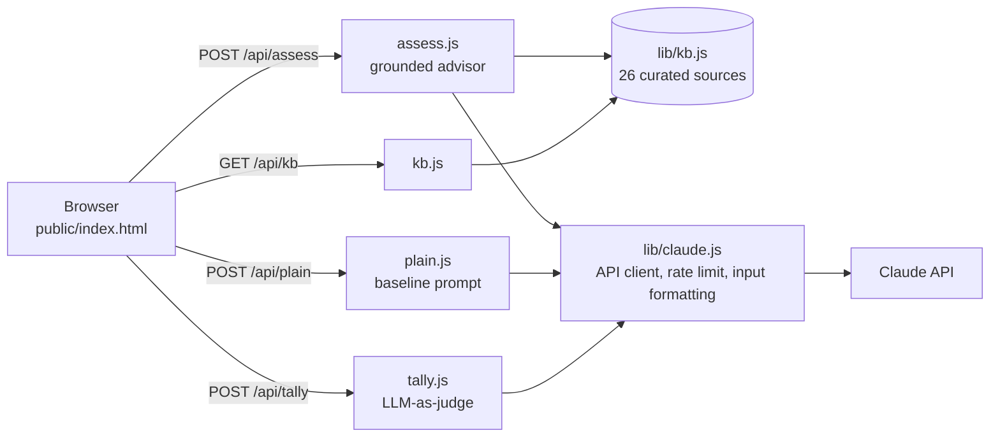

# FairPlay: AI Risk Advisor

**Know what to check before you build.**

FairPlay helps founders and product teams find the **privacy, bias, security, and regulatory risks** in an AI product idea *before* launch. It turns them into concrete next steps, and every finding links to an official source you can verify yourself.

**Live demo:** https://fairplay-risk-advisor.vercel.app
**Built for:** AIPI 590 (AI in Product Management), Duke University, Team 9 "FAIR PLAY"


---

## Table of contents

1. [The problem](#the-problem)
2. [Design principle: point, don't pronounce](#design-principle-point-dont-pronounce)
3. [Features](#features)
4. [How it works](#how-it-works)
5. [The knowledge base](#the-knowledge-base)
6. [Severity rubric and human review](#severity-rubric-and-human-review)
7. [API reference](#api-reference)
8. [Evaluation](#evaluation)
9. [Responsible AI: failure cases and mitigations](#responsible-ai-failure-cases-and-mitigations)
10. [Privacy, security and cost](#privacy-security-and-cost)
11. [Run locally](#run-locally)
12. [Deploy](#deploy)
13. [Maintaining the knowledge base](#maintaining-the-knowledge-base)
14. [Project structure](#project-structure)
15. [Limitations](#limitations)
16. [Roadmap](#roadmap)
17. [Team](#team)
18. [Disclaimer](#disclaimer)

---

## The problem

Founders ship AI products faster than they can learn what could go wrong: privacy, bias, security, regulation. Most early teams have no compliance person and can't afford a lawyer for every idea. Fixing a risk is cheap before launch and expensive after.

Asking a general-purpose chatbot is a common shortcut, but it gives confident answers that can be stale, generic, or cite laws and articles that don't exist, and it gives no way to check them.

## Design principle: point, don't pronounce

FairPlay never states what a law requires. It tells you **what may apply and what to check**, and links to the official text. Three rules follow from that:

1. **Cite-only.** The model may only cite IDs from a curated list of official sources. Our own code removes anything else.
2. **Show your reasoning.** Every severity rating comes with a one-line reason tied to a written rubric.
3. **Flag uncertainty.** Anything low-confidence, unsourced, or dependent on facts the founder didn't give is marked *Needs human review*.

## Features

**Guided intake**
- Tap-to-select form: product description, who it affects, whether it makes decisions about people, data used, user locations, and how the model is sourced.
- An **Other** option with free text on every question.
- Starter scenarios: Hiring, Wellness, Lending, Tutor.

**Results-first report**
- After you assess, the form collapses and the results take the whole page.
- **Risk snapshot:** overall count, severity donut, risks by category, when to act (fix now / before scaling / monitor), and human-review progress.
- **"Start here"** shortcuts to the top risks.
- Each risk card shows category, severity, a *when to act* tag, confidence, a one-line severity reason, why it matters, a concrete fix, linked official sources, and a human-review checkbox.
- **Ask a lawyer:** up to 3 questions to take to counsel.
- **Reviewer notes**, plus **Download report** (Markdown), **Email this report**, and **Copy summary**.

**Compare with a generic AI**
- Every assessment also runs the same description through a plain, ungrounded prompt. The *Compare* tab shows a side-by-side table (risk areas, laws named, concrete fixes, severity, human-review flags) and a "Bottom line", with the full answers one click away.

**Saved history (no login)**
- Past assessments are saved in **your own browser** (localStorage) and can be reopened or deleted. Nothing is sent to a server. Clearing browser data removes them.
- *Why not login:* no personal data is stored, founders can start in seconds, and accounts can come after a pilot.

**Trust and feedback**
- Footer dialogs: **How severity works** and **Sources** (the full list).
- Every risk has **Wrong or missing source? Report it on GitHub**, which opens a pre-filled issue labelled `kb-feedback`.

## How it works



One assessment makes **three requests**:

1. **`/api/assess`**: the grounded advisor. The founder's answers and the 26 official source pointers go into one Claude call with a strict rubric. Output is structured (tool use), not free text.
2. **`/api/plain`**: a baseline. Same description, a plain prompt ("What are the risks of this AI product idea?"), no knowledge base, no rules.
3. **`/api/tally`**: a small LLM-as-judge call that counts risk areas covered, named laws, and concrete fixes in the plain answer, so the Compare tab can show numbers instead of impressions.

**Stack**

| Layer | Details |
|---|---|
| Frontend | Single-page vanilla HTML/CSS/JS (`public/index.html`), no build step |
| Backend | Node.js 20 serverless functions on **Vercel** (`api/`), 60 s max duration |
| Model | Anthropic **Claude Sonnet 5.5** (`claude-sonnet-5-5`), configurable with `MODEL_DEFAULT` |
| Grounding | Curated pointer list in `lib/kb.js`, injected into the prompt; no fine-tuning, no vector database |
| Structured output | Claude tool use (`tools` with `tool_choice: auto` plus a "you MUST call the report tool" instruction). A missing tool call or a `max_tokens` stop is rejected as `invalid_json` |
| Guardrails | Cite-only prompt rules, schema enums, input length caps, per-IP rate limit, rate-limit and upstream errors surfaced to the UI |
| CI | Weekly GitHub Action that checks every knowledge-base link |

**Why tool use?** Early versions asked for JSON in plain text and occasionally got a malformed answer (one preset failed this way during testing). Switching to a tool schema with enums fixed it. This model rejects a forced `tool_choice`, hence `auto` plus the explicit instruction.

## The knowledge base

`lib/kb.js` is a list of **26 pointers**, not legal summaries. Each entry is `[id, source, category, title, "what to check", official link]`. It has a North Carolina layer plus federal, state, and EU/UK sources.

| Area | Entries |
|---|---|
| EU AI Act | `EUAI-5` prohibited practices, `EUAI-HR` high-risk uses, `EUAI-50` transparency |
| GDPR | `GDPR-5` lawful basis, `GDPR-9` special category data, `GDPR-22` automated decisions, `GDPR-32` security and breach, `GDPR-35` impact assessment |
| NIST | `NIST-MAP` govern and map, `NIST-MEAS` measure and manage, `NIST-GAI` generative AI profile (AI 600-1) |
| US federal | `FTC-5` deception and unfairness, `COPPA` children's online privacy, `HIPAA-PR` health information, `FDA-CDS` clinical decision support, `FERPA` student records, `CFPB-AA` credit decisions and explanations, `FINCEN-MSB` moving or holding customers' money |
| US state and local | `CCPA` California, `CO-AI` Colorado AI law, `NYC-144` NYC hiring tools |
| North Carolina | `NC-UDTPA` deceptive practices, `NC-IMG` AI-generated intimate images, `NC-BRCH` breach notice, `NC-SOPPA` student online privacy, `NC-WATCH` pending bills |

The knowledge base grew from 19 to 26 entries after the evaluation exposed gaps (education records, health data, children's privacy, credit, payments).

**Citation rules the model must follow**
- Cite a source only if its "what to check" text directly addresses that specific risk; at most 2 per risk.
- No `GDPR-*` or `EUAI-*` unless EU/UK is among the user's locations; no `CCPA` unless California is.
- `NIST-MAP` only for governance/documentation risks; `NC-WATCH` only for pending chatbot or privacy bills. Never as filler.
- If a real risk has no fitting source, include it with empty sources, `confidence: low`, `needsReview: true`.

## Severity rubric and human review

| Severity | Meaning | When to act |
|---|---|---|
| **High** | Could block launch or directly harm people, with no safeguard described (e.g. automated decisions about people, sensitive or minors' data) | Fix now |
| **Medium** | Plausibly applies; needs a mitigation before scaling or wider release | Fix before scaling |
| **Low** | Good practice, or only applies under conditions the founder didn't state | Monitor |

Severity is an **AI judgment against this rubric**, shown with its reason so you can challenge it. The **human-review flag is rule-based**: it triggers on low confidence or a missing source.

## API reference

| Endpoint | Method | Purpose |
|---|---|---|
| `/api/assess` | POST | Grounded risk assessment |
| `/api/plain` | POST | Baseline answer from a plain prompt |
| `/api/tally` | POST | Scores an answer: `{ categories[], cites, fixes }` |
| `/api/kb` | GET | Returns the knowledge base |

**Request body** (`/api/assess`, `/api/plain`)

```json
{
  "idea": "A loan pre-qualification tool that estimates eligibility from bank-linked transaction data.",
  "users": "Consumers",
  "dec": "Decides automatically",
  "data": ["Financial data", "Transaction history"],
  "geo": ["North Carolina"],
  "model": "Third-party API"
}
```

`idea` must be at least 20 characters. Text fields are length-capped and lists limited to 12 items.

**Response** (`/api/assess`)

```json
{
  "data": {
    "summary": "2 sentences",
    "risks": [{
      "category": "privacy | bias | security | regulatory",
      "severity": "high | medium | low",
      "severityWhy": "one line naming the rubric criterion",
      "when": "now | before-scaling | monitor",
      "title": "", "why": "", "fix": "",
      "sources": ["NIST-MEAS", "CFPB-AA"],
      "confidence": "high | medium | low",
      "needsReview": true
    }],
    "askLawyer": ["..."]
  }
}
```

**Errors:** `400` (idea too short), `405` (not POST), `429` (`rate_limited`), `500` (`invalid_json` or `upstream_error`).

## Evaluation

We tested FairPlay against a plain prompt on a small fixed set, and graded every citation.

### The 10-scenario test

We made up ten AI products and wrote down the risks a good advisor should catch (**41 in total**) *before running anything*.

| ID | Product | Expected risks |
|---|---|---|
| S1 | Resume screener | 4 |
| S2 | Mental wellness chatbot | 5 |
| S3 | Loan pre-approval | 4 |
| S4 | AI tutor for high schoolers | 4 |
| S5 | Dental note-taking assistant | 4 |
| S6 | Face-match door access | 4 |
| S7 | Marketing copy generator | 3 |
| S8 | Peer help marketplace | 5 |
| S9 | Employee monitoring | 4 |
| S10 | Insurance claims triage | 4 |

**Method**
1. Each scenario is a filled-in intake form (`eval/scenarios.json`) with its expected risks.
2. `eval/run_eval.py` sends every scenario to `/api/assess` and `/api/plain` (about 3 API calls per run) and saves the outputs.
3. Each expected risk is scored 1 (covered) or 0 (not covered) for FairPlay and for the plain prompt.
4. Every FairPlay citation is graded **Fits** (the source directly addresses the risk), **Partial** (related but generic), or **Poor** (doesn't address it).

### Results

| Metric | Before the fix | After the fix |
|---|---|---|
| Citations that fit | 76% | **94%** |
| Partial fit | 18% | 6% |
| Poor fit | 6% (7 citations) | **0** |
| Expected risks found | | **41 / 41** (FairPlay) and **41 / 41** (plain prompt) |

**Recall** is the share of expected risks a tool found: risks found ÷ risks expected. Both tools reached 100%, so **recall is not where FairPlay wins**. The difference is what comes with the risks: official links, a reason for each severity, and review flags.

What the test changed:
- Citations were tightened (the citation rules above) and the knowledge base grew from 19 to 26 sources.
- Gaps found: no student-privacy source for the tutor, no health-data source for the dental tool, no credit source for the loan tool. All now cited.
- **Still open:** marketplace safety and state recording-consent laws. FairPlay flags these for a human instead of guessing.

### Caveats (please read)

- Small test: 10 scenarios, **one run each**. Treat results as direction, not proof.
- Recall was scored leniently with AI-assisted, keyword-style judging.
- S4 and S7 flipped from missed to found without any knowledge-base change, which suggests run-to-run variation. A 3-run stability check would size it.
- Citation-fit grading was done by Claude with knowledge of the prompt change; a teammate should spot-check about 5 rows.
- The plain-prompt baseline needed a 3,500-token limit to avoid truncation.

### Reproduce

```bash
cd eval
python3 run_eval.py        # one run per scenario
python3 run_eval.py 3      # three runs each (stability check)
ONLY=S3,S4 python3 run_eval.py   # a subset
```

Outputs go to `eval/results/`, plus a blank `score_sheet.csv` to fill in. Saved runs are in `eval/results_before/` (before the citation fix) and `eval/results_after_citations/` (after). Note: this calls the live app and uses API credits.

## Responsible AI: failure cases and mitigations

| Failure | What we do |
|---|---|
| Wrong or invented source | Model may cite only list IDs; code drops anything else |
| Missed or mis-ranked risk | Written severity rubric, visible reason, human-review flags |
| Sounds like legal advice | "Point, don't state" prompt rule, disclaimer on every report, Ask-a-lawyer questions |
| Stale source | Weekly link check, per-risk report link (`kb-feedback` issues) |
| Generic or filler citations | Citation rules, 94% fit measured |

**Still open:** 6% of citations are only a partial fit, and severity is an AI judgment. FairPlay does not replace a lawyer.

## Privacy, security and cost

- **No accounts and no server-side storage.** Saved history lives in your browser's localStorage only.
- **What leaves your browser:** the product description and form answers are sent to our serverless functions, which forward them to the Claude API. Don't paste confidential or personal data into the description.
- **API key** lives only in a Vercel environment variable. It is never in the repo (`.env` is git-ignored).
- **Abuse control:** per-IP rate limit (default 20 requests per hour, `RATE_LIMIT_PER_HOUR`); it is in-memory per serverless instance, so it is a soft limit. Set a spend limit in the Anthropic Console as the hard stop.
- **Cost (estimate):** about **$0.06 per assessment**, so roughly $60 per 1,000. Treat this as an estimate until confirmed against billing.
- **Speed:** a report takes up to about a minute. Across about 25 runs we saw one transient error.

## Run locally

Requires Node.js 20+ and an Anthropic API key.

```bash
git clone https://github.com/sejal-jagtap/ai-risk-advisor.git
cd ai-risk-advisor
npm i -g vercel
```

Create a `.env` file (never commit it):

```
ANTHROPIC_API_KEY=your_key_here
MODEL_DEFAULT=claude-sonnet-5-5   # optional
RATE_LIMIT_PER_HOUR=20            # optional, per IP
```

Start the dev server and open http://localhost:3000:

```bash
vercel dev
```

## Deploy

1. Import the repo into Vercel.
2. Add `ANTHROPIC_API_KEY` (and optionally `MODEL_DEFAULT`, `RATE_LIMIT_PER_HOUR`) under Project Settings > Environment Variables.
3. Deploy. Pushes to `main` redeploy automatically. `vercel.json` sets a 60 s limit on functions.

## Maintaining the knowledge base

**Add or change a source:** edit `lib/kb.js` and add an entry `[id, source, category, title, "what to check", "official link"]`. Write it as a *pointer* (what to check), never a summary of what the law requires. Run the evaluation again if the change affects citations.

**Link checking:** `scripts/check_links.js` requests every source URL. A 404 or 410 counts as dead (exit 1). 403, 429 and timeouts are reported as "unverified" only. The GitHub Action in `.github/workflows/kb-links.yml` runs it **every Monday** (and on demand) and opens an issue labelled `kb-feedback` if any link is dead.

```bash
node scripts/check_links.js
```

**User feedback:** the *Wrong or missing source?* link on every risk opens a pre-filled GitHub issue with the risk title, category, and sources cited. Create the `kb-feedback` label in the repo once so issues are labelled.

## Project structure

```
├── api/
│   ├── assess.js        # grounded advisor endpoint (schema, rules, citation constraints)
│   ├── plain.js         # baseline prompt endpoint
│   ├── tally.js         # LLM-as-judge scoring
│   └── kb.js            # serves the knowledge base
├── lib/
│   ├── claude.js        # API client, tool-use output, rate limiting, input formatting
│   └── kb.js            # 26 curated source pointers
├── public/
│   ├── index.html       # frontend: intake, snapshot, risk cards, compare, history, dialogs
│   └── hero.jpg
├── eval/
│   ├── scenarios.json   # the 10 scenarios and expected risks
│   ├── run_eval.py      # runs scenarios through FairPlay and the plain prompt
│   ├── score_sheet.csv  # blank scoring template
│   ├── results_before/  # saved runs before the citation fix
│   └── results_after_citations/  # saved runs after
├── scripts/
│   └── check_links.js   # knowledge-base link checker
├── .github/workflows/
│   └── kb-links.yml     # weekly link check
└── vercel.json
```

## Limitations

- **Not legal advice.** Pointers only; coverage is incomplete (26 sources) and the knowledge base needs a named reviewer to stay current.
- **Severity is an AI judgment**, not a legal determination.
- **Small evaluation:** one run per scenario, AI-assisted grading, tied a plain prompt on recall.
- **Jurisdictions:** strongest for North Carolina plus a few federal, state, and EU sources; many states and sectors are not covered.
- **Open gaps:** marketplace safety and state recording-consent laws (flagged for human review).
- **Rate limiting** is per serverless instance, not global.
- **Willingness to pay is unvalidated.**

## Roadmap

- Pilot with 5 Duke founders and test 3 price points
- Repeat each evaluation scenario 3 times to measure stability
- Optional accounts and a database for saved history; a named knowledge-base reviewer
- More sectors and states; close the two open gaps
- Shared rate-limit store (e.g. Vercel KV / Upstash)
- PDF export of reports

## Team

**Team 9, "FAIR PLAY"**: Sam Arokiaswamy, Sejal Jagtap, Pranav Yellarthi, Mihir Kosuri
AIPI 590, AI in Product Management, Duke University.

Repository author: **Sejal Jagtap**, M.S. Interdisciplinary Data Science, Duke University
[LinkedIn](https://www.linkedin.com/in/sejaljagtap) · [GitHub](https://github.com/sejal-jagtap)

## Disclaimer

FairPlay points you to what to check. It does **not** state what any law requires and can be incomplete or wrong. Verify every point at the linked official source and review it with qualified counsel before relying on it.
