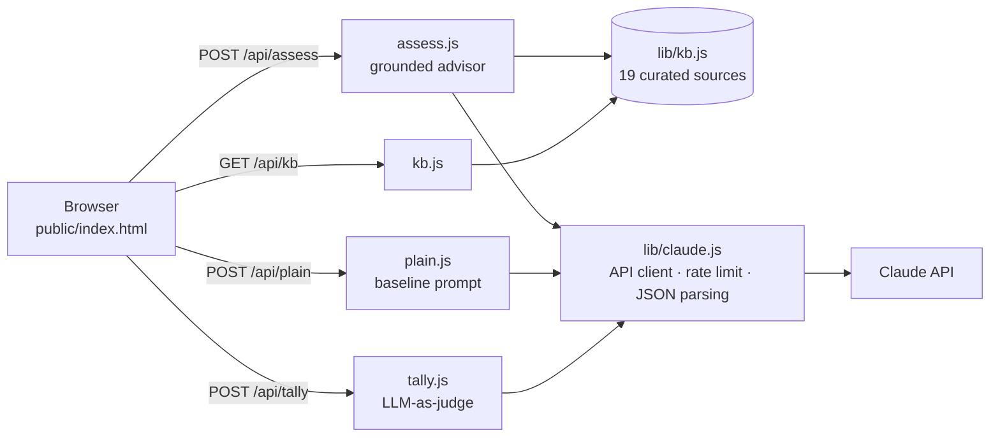

# FairPlay: AI Risk Advisor

**Know what to check before you build.**

FairPlay helps founders and product teams find the **privacy, bias, security, and regulatory risks** in an AI product idea before launch. It turns them into concrete next steps, with each finding linked to an official source to verify.

🔗 **Live demo:** https://fairplay-risk-advisor.vercel.app


---

## Why

Early-stage teams building with AI often don't know which rules might apply to them, such as the EU AI Act, GDPR, NYC's hiring-tool law, or state privacy laws. They also can't afford a lawyer for every idea. Asking a general-purpose LLM gives confident answers that may be wrong and often cite laws or articles that don't exist.

FairPlay is built to **point, not pronounce**. It tells you *what may apply and what to check*, grounds every citation in a curated source list, and flags anything uncertain for human review.

## Features

- **Guided assessment.** Describe the product, who it affects, whether it makes decisions about people, what data it uses, where users are, and how the model is sourced. Starter scenarios are included: hiring, wellness, lending, tutoring.
- **Structured risk report.** 4–8 risks across four categories, each with severity, rationale, a concrete product or data fix, cited sources, and a confidence level.
- **Grounded citations.** The model can only cite IDs from a curated knowledge base of **19 official sources** (EU AI Act, GDPR, NIST AI RMF, NIST AI 600-1, FTC Act §5, CCPA, Colorado SB 24-205, NYC Local Law 144, and North Carolina statutes). Each links to the official text.
- **Human-in-the-loop review.** Low-confidence or fact-dependent risks are marked *Needs human review* and can be ticked off once someone qualified has checked them.
- **Questions for counsel.** Up to three questions to take to a lawyer.
- **Side-by-side evaluation.** Every assessment also runs a plain, ungrounded prompt. An LLM-as-judge then scores the plain answer on risk categories covered, specific laws cited, and concrete fixes, so you can compare it with the grounded report.

## Architecture



| Layer | Details |
|---|---|
| Frontend | Single-page vanilla HTML/CSS/JS (`public/index.html`) |
| Backend | Node.js 20 serverless functions on **Vercel** (`api/`) |
| LLM | Anthropic Claude API (model configurable via env var) |
| Grounding | Curated source list in `lib/kb.js`, injected into the prompt; citations restricted to its IDs |
| Guardrails | Prompt rules (no stating legal requirements, dates, or penalties), strict JSON output schema with validation, input length caps, per-IP rate limiting |

### API

| Endpoint | Method | Purpose |
|---|---|---|
| `/api/assess` | POST | Grounded risk assessment → `{ summary, risks[], askLawyer[] }` |
| `/api/plain` | POST | Baseline answer from a generic prompt, for comparison |
| `/api/tally` | POST | LLM-as-judge scoring of an answer: `{ categories[], cites, fixes }` |
| `/api/kb` | GET | Returns the knowledge base |

## Run locally

```bash
git clone https://github.com/sejal-jagtap/ai-risk-advisor.git
cd ai-risk-advisor
npm i -g vercel
```

Create a `.env` file:

```
ANTHROPIC_API_KEY=your_key_here
MODEL_DEFAULT=claude-sonnet-5-5   # optional
RATE_LIMIT_PER_HOUR=20            # optional, per IP
```

Then start the dev server:

```bash
vercel dev
```

Open http://localhost:3000.

## Project structure

```
├── api/
│   ├── assess.js   # grounded advisor endpoint
│   ├── plain.js    # baseline prompt endpoint
│   ├── tally.js    # LLM-as-judge scoring
│   └── kb.js       # serves the knowledge base
├── lib/
│   ├── claude.js   # API client, JSON parsing, rate limiting, input formatting
│   └── kb.js       # curated regulatory sources
├── public/
│   └── index.html  # frontend
└── vercel.json
```

## Roadmap

- Move rate limiting to a shared store (e.g., Vercel KV / Upstash) so limits hold across serverless instances
- Build a fixed evaluation set of product ideas and report grounded-vs-baseline metrics
- Expand the knowledge base to more jurisdictions
- Export reports to PDF

## Disclaimer

FairPlay points you to what to check. It does **not** state what any law requires and can be incomplete or wrong. Verify every point at the linked official source and review it with qualified counsel before relying on it.

## Author

**Sejal Jagtap**, M.S. Interdisciplinary Data Science, Duke University
[LinkedIn](https://www.linkedin.com/in/sejaljagtap) · [GitHub](https://github.com/sejal-jagtap)
